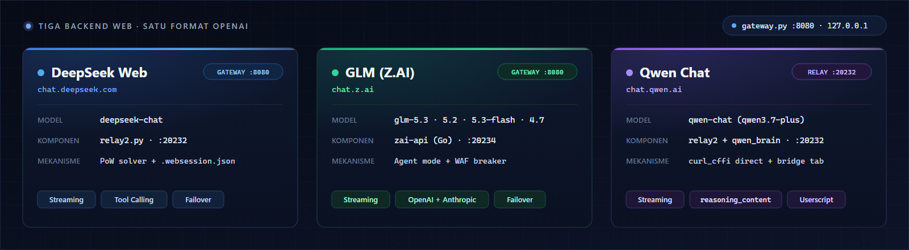
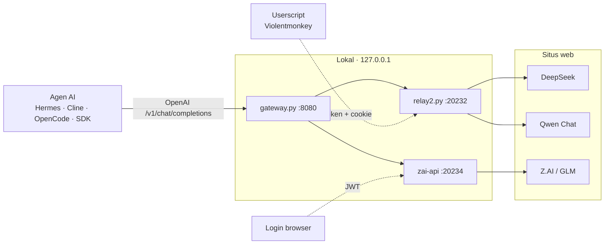
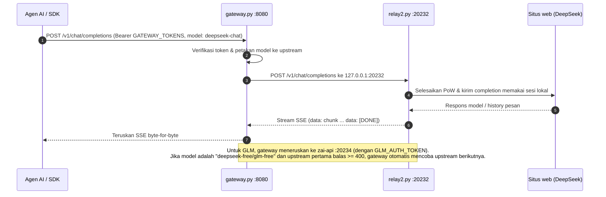

<a id="atas"></a>

<div align="center">
  

  <h1>Free Web LLM Gateway</h1>

  <p>
    Satu endpoint yang kompatibel dengan OpenAI untuk <b>DeepSeek</b>, <b>GLM&nbsp;(Z.AI)</b>, dan <b>Qwen</b>.<br>
    Memakai sesi login akun sendiri — bukan API key resmi.
  </p>

  <p>
    
    
    
    
    
  </p>

  <p>
    <a href="#kenapa-memakai-ini">Kenapa</a> ·
    <a href="#backend-yang-didukung">Backend</a> ·
    <a href="#arsitektur">Arsitektur</a> ·
    <a href="#mulai-cepat">Mulai cepat</a> ·
    <a href="#contoh-pemakaian">Contoh kode</a> ·
    <a href="#troubleshooting">Troubleshooting</a> ·
    <a href="#keamanan">Keamanan</a>
  </p>
</div>

> [!WARNING]
> **Hanya source code.** Token, cookie, dan database sesi tidak disertakan dan tidak boleh masuk Git.

## Kenapa memakai ini?

Menghubungkan agen AI (Hermes, Cline, OpenCode, SDK OpenAI, dan sejenisnya) ke chat web **DeepSeek**, **GLM (Z.AI)**, dan **Qwen** lewat satu antarmuka lokal yang kompatibel dengan OpenAI (`/v1/chat/completions`).

<table>
  <tr>
    <td width="33%" valign="top">
      <b>Satu API, tiga backend web</b><br>
      Cukup ganti nama model tanpa mengubah klien. Gateway menyatukan <code>/v1/models</code>, mendukung prefix upstream (<code>glm-free/glm-5.3</code>), dan meneruskan <code>/v1/messages</code> (Anthropic) untuk GLM.
    </td>
    <td width="33%" valign="top">
      <b>Streaming, tools, dan failover</b><br>
      Streaming SSE byte-for-byte di gateway, <code>reasoning_content</code> di Qwen, <i>agent mode</i> untuk function calling di GLM, plus failover otomatis lintas-upstream lewat <code>deepseek-free/glm-free</code>.
    </td>
    <td width="33%" valign="top">
      <b>Lokal dengan sesi sendiri</b><br>
      Berjalan di <code>127.0.0.1</code> memakai sesi login browser Anda tanpa API key berbayar. <code>gateway.py</code> murni memakai stdlib Python tanpa dependensi tambahan.
    </td>
  </tr>
</table>

<details>
<summary><b>Daftar isi lengkap</b></summary>

- [Kenapa memakai ini?](#kenapa-memakai-ini)
- [Backend yang didukung](#backend-yang-didukung)
- [Arsitektur](#arsitektur)
  - [Topologi komponen](#topologi-komponen)
  - [Alur satu request](#alur-satu-request)
- [Persyaratan](#persyaratan)
- [Mulai cepat](#mulai-cepat)
  - [Qwen (diuji di Windows)](#qwen-diuji-di-windows)
  - [DeepSeek](#deepseek)
  - [GLM](#glm)
  - [Gateway gabungan](#gateway-gabungan)
- [Contoh pemakaian](#contoh-pemakaian)
  - [Gateway gabungan (curl dan Python SDK)](#gateway-gabungan-curl-dan-python-sdk)
  - [Contoh per backend](#contoh-per-backend)
  - [Konfigurasi di agen AI](#konfigurasi-di-agen-ai)
- [Troubleshooting](#troubleshooting)
- [Dokumentasi](#dokumentasi)
- [Struktur repo](#struktur-repo)
- [Keamanan](#keamanan)
- [Batasan yang perlu diketahui](#batasan-yang-perlu-diketahui)
- [Lisensi](#lisensi)

</details>

---

## Backend yang didukung

<p align="center">
  
</p>

| Backend | Status di Gateway | Model | Port | Komponen | Streaming & Tools | Sumber sesi |
|---|---|---|---|---|---|---|
|  |  | `deepseek-chat` | `20232` | `dsh-better-bridge/relay/relay2.py` | SSE · tool calling OK | `.websession.json` (`userToken` + cookie) |
|  |  | `glm-5.3`, `glm-5.2`, `glm-5.3-flash`, `glm-4.7` | `20234` | `glm-free-api/` (Go) | SSE · tools (`--agent-mode`) · `/v1/messages` | `.zai-token` (JWT) + `tokens.sqlite` |
|  |  | `qwen-chat` (`qwen3.7-plus`) + ID Qwen lain | `20232` | `relay2.py` + `qwen_brain.py` | SSE (`reasoning_content` + `content`) · `<tool_call>` | Userscript Violentmonkey di tab `chat.qwen.ai` |
|  |  | Semua upstream di `DEFAULT_UPSTREAMS` + failover `deepseek-free/glm-free` | `8080` | `gateway.py` (stdlib Python) | SSE byte-for-byte · auth `GATEWAY_TOKENS` | Menyuntikkan token upstream per backend |

> [!NOTE]
> `DEFAULT_UPSTREAMS` di `gateway.py` saat ini memuat `deepseek-free` (`:20232`) dan `glm-free` (`:20234`). Qwen belum masuk ke daftar tersebut sehingga `GET :8080/v1/models` belum menampilkannya dan request `qwen-*` lewat gateway belum diuji — arahkan klien langsung ke `http://127.0.0.1:20232/v1` untuk Qwen.

<p align="right"><a href="#atas">↑ Kembali ke atas</a></p>

---

## Arsitektur

### Topologi komponen



<details>
<summary>Versi teks (untuk renderer tanpa Mermaid)</summary>

```text
Agen (Hermes / Cline / ...)
        |  OpenAI /v1/chat/completions
        v
  gateway.py :8080 --------+-----------------------+
                           |                       |
                           v                       v
                  relay2.py :20232          zai-api :20234
                  DeepSeek  |  Qwen              GLM
                           ^
                           | token + cookie dari browser
                  userscript (Violentmonkey)
```
</details>

DeepSeek dan Qwen berbagi satu relay (`relay2.py`). Relay memilih backend dari awalan nama model: `qwen*` ke Qwen, selain itu ke DeepSeek.

### Alur satu request

Diagram berikut menggambarkan satu panggilan `chat/completions` dari agen hingga situs web dan kembali sebagai stream SSE:



Untuk **Qwen**, klien memanggil `relay2.py :20232` secara langsung. Relay mencoba jalur `direct` (`curl_cffi` TLS Firefox + cookie WAF, mendukung streaming `reasoning_content`) lebih dulu, lalu otomatis jatuh ke jalur `bridge` (userscript di tab `chat.qwen.ai`) bila jalur direct gagal atau tertahan WAF.

<p align="right"><a href="#atas">↑ Kembali ke atas</a></p>

---

## Persyaratan

| Kebutuhan | Keterangan |
|---|---|
| Python | 3.10+ dan `pip install -r requirements.txt` (`deepseek-pow==0.0.1`) |
| Qwen | `pip install curl_cffi` (sidik TLS browser; diuji dengan `0.17.0`) |
| GLM | Go sesuai [`glm-free-api/go.mod`](glm-free-api/go.mod) (`1.25.4`) |
| Akun | `chat.deepseek.com`, `chat.qwen.ai`, dan/atau `chat.z.ai` |
| Browser | Violentmonkey / Tampermonkey untuk Qwen (dan browser untuk mengambil sesi/token) |

---

## Mulai cepat

<details open>
<summary><b>Pilih jalur pemasangan</b></summary>

| Backend | Langkah ringkas | Endpoint lokal |
|---|---|---|
| [Qwen](#qwen-diuji-di-windows) | Jalankan relay, pasang userscript, biarkan tab terbuka | `http://127.0.0.1:20232/v1` |
| [DeepSeek](#deepseek) | Simpan sesi browser ke `.websession.json`, jalankan relay | `http://127.0.0.1:20232/v1` |
| [GLM](#glm) | Simpan JWT, siapkan token device, build `zai-api`, jalankan `./start-glm.sh` | `http://127.0.0.1:20234/v1` |
| [Gateway gabungan](#gateway-gabungan) | `export GATEWAY_TOKENS=... && ./start.sh` | `http://127.0.0.1:8080/v1` |

</details>

### Qwen (diuji di Windows)

1. Pasang dependensi TLS: `pip install curl_cffi`
2. Jalankan relay: `python dsh-better-bridge/relay/relay2.py`, atau jalankan `dsh-better-bridge/relay/start-relay.bat`.
3. Pasang [`dsh-better-bridge/userscripts/qwen-token-relay.user.js`](dsh-better-bridge/userscripts/qwen-token-relay.user.js) di Violentmonkey, buka `chat.qwen.ai`, login, dan biarkan tab terbuka.
4. Pastikan panel userscript menampilkan `sesi tersinkron`, lalu uji dengan contoh `curl` di bagian [Contoh per backend](#contoh-per-backend).

Panduan lengkap, daftar model (`qwen3.7-plus`, `qwen3.8-max`, `qwen3.7-max`, `qwen3.6-plus`), dan catatan teknis: [`docs/QWEN-CHAT.md`](docs/QWEN-CHAT.md).

### DeepSeek

1. Login ke `chat.deepseek.com`, ambil `userToken` dari `localStorage` dan cookie browser.
2. Simpan ke `dsh-better-bridge/relay/.websession.json` dengan format `{"token":"...","cookies":{}}` lalu amankan izinnya (`chmod 600`).
3. Jalankan `python dsh-better-bridge/relay/relay2.py`.

Token DeepSeek bisa berputar sendiri. Relay menerima token baru lewat `POST /session` dan membaca ulang file sesi saat berubah tanpa restart, tetapi userscript pendorong untuk DeepSeek **tidak disertakan** di repo ini.

### GLM

1. Login ke `chat.z.ai`, salin key `token` dari `localStorage`, lalu simpan ke `glm-free-api/.zai-token` (`chmod 600`).
2. Siapkan stok device token lewat `token-collector` (butuh mode headful; gunakan `xvfb-run -a` di server — lihat [`glm-free-api/README.md`](glm-free-api/README.md)).
3. Bangun binary bridge: `cd glm-free-api && go build -o zai-api .`
4. Simpan token klien lokal di `glm-free-api/.glm-auth-token`, lalu jalankan `./start-glm.sh` (menyalakan `zai-api --agent-mode` di port `20234`).

### Gateway gabungan

```sh
export GATEWAY_TOKENS="isi-token-acak-yang-kuat"
./start.sh          # menyalakan relay DeepSeek + bridge GLM + gateway :8080
./start.sh stop     # menghentikan ketiganya
```

`start.sh` menolak jalan tanpa `GATEWAY_TOKENS`. Port dan upstream dikonfigurasi di [`gateway.py`](gateway.py) (`DEFAULT_UPSTREAMS`). Setelah menyala, jalankan verifikasi otomatis sebelum menghubungkan agen:

```sh
GW=http://127.0.0.1:8080 GATEWAY_TOKEN="$GATEWAY_TOKENS" python3 selfcheck.py
```

`selfcheck.py` menguji `/health`, `/v1/models`, `/v1/upstreams`, chat non-stream, streaming SSE (`data: [DONE]`), tool calling, dan rantai failover.

<p align="right"><a href="#atas">↑ Kembali ke atas</a></p>

---

## Contoh pemakaian

### Gateway gabungan (curl dan Python SDK)

#### `curl` — cek model, chat, dan failover

```sh
# 1. Lihat daftar model gabungan dari upstream yang aktif
curl http://127.0.0.1:8080/v1/models \
  -H "Authorization: Bearer $GATEWAY_TOKENS"

# 2. Chat ke model tertentu (ganti "deepseek-chat" ke "glm-5.3" untuk GLM)
curl http://127.0.0.1:8080/v1/chat/completions \
  -H "Content-Type: application/json" \
  -H "Authorization: Bearer $GATEWAY_TOKENS" \
  -d '{
    "model": "deepseek-chat",
    "stream": false,
    "messages": [{"role": "user", "content": "Balas satu kata: pong"}]
  }'

# 3. Failover otomatis: coba DeepSeek dulu, jika gagal (>= 400) pindah ke GLM
curl http://127.0.0.1:8080/v1/chat/completions \
  -H "Content-Type: application/json" \
  -H "Authorization: Bearer $GATEWAY_TOKENS" \
  -d '{
    "model": "deepseek-free/glm-free",
    "stream": false,
    "messages": [{"role": "user", "content": "Halo, jawab singkat."}]
  }'
```

#### Python — OpenAI SDK

*(Hanya sisi klien yang memakai paket `openai`; `gateway.py` sendiri murni stdlib Python.)*

```python
import os
from openai import OpenAI

client = OpenAI(
    base_url="http://127.0.0.1:8080/v1",
    api_key=os.environ["GATEWAY_TOKENS"],
)

# Non-streaming (bisa ganti model: "deepseek-chat", "glm-5.3", "glm-5.3-flash", "deepseek-free/glm-free")
resp = client.chat.completions.create(
    model="deepseek-chat",
    messages=[{"role": "user", "content": "Ringkas fungsi reverse proxy dalam dua kalimat."}],
)
print(resp.choices[0].message.content)

# Streaming SSE
stream = client.chat.completions.create(
    model="glm-5.3",
    stream=True,
    messages=[{"role": "user", "content": "Hitung 1 sampai 5."}],
)
for chunk in stream:
    delta = chunk.choices[0].delta.content
    if delta:
        print(delta, end="", flush=True)
print()
```

### Contoh per backend

<details open>
<summary><b>DeepSeek</b> — lewat gateway <code>:8080</code> (atau relay langsung <code>:20232</code>)</summary>

```sh
# Memaksa upstream DeepSeek lewat gateway (:8080)
curl http://127.0.0.1:8080/v1/chat/completions \
  -H "Content-Type: application/json" \
  -H "Authorization: Bearer $GATEWAY_TOKENS" \
  -d '{"model":"deepseek-free/deepseek-chat","stream":false,"messages":[{"role":"user","content":"ping"}]}'
```

</details>

<details>
<summary><b>GLM (Z.AI)</b> — OpenAI <code>/v1/chat/completions</code> dan Anthropic <code>/v1/messages</code> lewat gateway <code>:8080</code></summary>

```sh
# OpenAI-compatible ke GLM (memaksa upstream glm-free)
curl http://127.0.0.1:8080/v1/chat/completions \
  -H "Content-Type: application/json" \
  -H "Authorization: Bearer $GATEWAY_TOKENS" \
  -d '{"model":"glm-free/glm-5.3","stream":false,"messages":[{"role":"user","content":"ping"}]}'

# Anthropic-compatible (/v1/messages) juga diteruskan oleh gateway ke GLM
curl http://127.0.0.1:8080/v1/messages \
  -H "Content-Type: application/json" \
  -H "x-api-key: $GATEWAY_TOKENS" \
  -H "anthropic-version: 2023-06-01" \
  -d '{"model":"glm-5.3","max_tokens":512,"messages":[{"role":"user","content":"ping"}]}'
```

</details>

<details>
<summary><b>Qwen Chat</b> — langsung ke relay <code>:20232</code> (mendukung streaming <code>reasoning_content</code>)</summary>

```sh
# Non-streaming
curl http://127.0.0.1:20232/v1/chat/completions \
  -H "Content-Type: application/json" \
  -d '{"model":"qwen-chat","stream":false,"messages":[{"role":"user","content":"ping"}]}'

# Streaming (jalur direct; fase berpikir dikirim sebagai reasoning_content)
curl -N http://127.0.0.1:20232/v1/chat/completions \
  -H "Content-Type: application/json" \
  -d '{"model":"qwen-chat","stream":true,"messages":[{"role":"user","content":"Jelaskan HTTP/2 singkat."}]}'
```

</details>

### Konfigurasi di agen AI

| Pengaturan | Nilai |
|---|---|
| Base URL | `http://127.0.0.1:8080/v1` (gateway) atau `http://127.0.0.1:20232/v1` (relay langsung, wajib untuk Qwen) |
| API key | Token `GATEWAY_TOKENS` yang Anda tetapkan (header `Authorization: Bearer` atau `x-api-key`) |
| Model | `deepseek-chat` · `glm-5.3` · `glm-5.2` · `glm-5.3-flash` · `glm-4.7` · `qwen-chat` (cek `GET /v1/models`) |
| Prefix & failover | `deepseek-free/deepseek-chat`, `glm-free/glm-5.3`, atau `deepseek-free/glm-free` |
| Cek kesehatan | `GET /health` (tanpa token) · `GET /v1/upstreams` (butuh token) |

Qwen mendukung streaming: proses berpikir dan status tool bawaan Qwen dikirim sebagai `reasoning_content`, jawaban sebagai `content`. Tool call dari agen tetap berjalan lewat format `<tool_call>` di prompt.

Untuk prompt siap tempel (Hermes, Cline, Roo, Continue, dan verifikasi mandiri oleh agen), lihat [`docs/PROMPT-SHARE.md`](docs/PROMPT-SHARE.md).

<p align="right"><a href="#atas">↑ Kembali ke atas</a></p>

---

## Troubleshooting

| Gejala | Penyebab | Tindakan |
|---|---|---|
| `./start.sh` langsung berhenti dengan error `GATEWAY_TOKENS` | Variabel lingkungan `GATEWAY_TOKENS` belum diset | Jalankan `export GATEWAY_TOKENS="token-acak-kuat"` lalu ulangi `./start.sh` |
| HTTP `401 Unauthorized` di gateway `:8080` | Header `Authorization: Bearer` atau `x-api-key` kosong/tidak cocok | Samakan API key klien dengan nilai `GATEWAY_TOKENS` |
| HTTP `502` dengan daftar `attempts` | Semua upstream dalam rantai gagal (token kedaluwarsa atau WAF) | Baca detail per upstream di field `attempts`: perbarui `.websession.json` jika DeepSeek `401`, atau tunggu `retryIn` jika GLM `waf_block` |
| DeepSeek `session_expired` (`40003`) atau `401` | `userToken` DeepSeek sudah kedaluwarsa / berputar | Login ulang di `chat.deepseek.com`, lalu perbarui `.websession.json` atau dorong lewat `POST /session` |
| GLM `503` (`waf_block`) atau `405` HTML Aliyun | IP sementara ditahan Aliyun WAF pada `/api/v2/chat/completions` | Tunggu sesuai header `Retry-After` / `retryIn` (circuit breaker pulih otomatis dengan backoff `60s` → `30m`); pantau di `GET :20234/status` |
| GLM `captcha generation returned empty payload` / `tokenCount: 0` | Stok device token di `tokens.sqlite` habis | Cek `GET :20234/health`, lalu isi ulang lewat `token-collector` dalam mode headful (`xvfb-run -a` di server) |
| Qwen `Bad_Request - Internal error...` | Header `Version` hilang atau usang terhadap frontend `chat.qwen.ai` (`0.3.40` saat diuji) | Set env `QWEN_APP_VERSION` agar cocok dengan versi frontend Qwen terbaru |
| Qwen `unauthorized` / `401` (kadang di dalam HTTP 200) | Token push (~13 menit) sudah basi | Buka/reload tab `chat.qwen.ai` agar userscript mendorong token baru; periksa `exp_in` di log relay |
| Qwen `tidak ada tab yang polling bridge` atau respons HTML / `x5secdata` | Tab `chat.qwen.ai` tertutup, userscript mati, atau cookie WAF basi | Buka dan reload tab `chat.qwen.ai`, pastikan panel userscript menampilkan `sesi tersinkron` |
| `qwen-chat` tidak muncul di `GET :8080/v1/models` | `DEFAULT_UPSTREAMS` di `gateway.py` belum memuat Qwen | Arahkan klien langsung ke `http://127.0.0.1:20232/v1` untuk Qwen |

<p align="right"><a href="#atas">↑ Kembali ke atas</a></p>

---

## Dokumentasi

| Dokumen | Isi |
|---|---|
| [`docs/QWEN-CHAT.md`](docs/QWEN-CHAT.md) | Setup Qwen, dua jalur transport (`direct`/`bridge`), token, streaming, variabel lingkungan, troubleshooting |
| [`docs/PELAJARAN-PEMASANGAN.md`](docs/PELAJARAN-PEMASANGAN.md) | Catatan pemasangan nyata DeepSeek, GLM, gateway, dan urutan setup dari nol |
| [`docs/PROMPT-SHARE.md`](docs/PROMPT-SHARE.md) | Prompt siap tempel agar agen lain (Hermes, Cline, dll.) memakai gateway ini |
| [`glm-free-api/README.md`](glm-free-api/README.md) | Referensi lengkap bridge GLM: API OpenAI/Anthropic, agent mode, WAF circuit breaker, token pool |

## Struktur repo

```text
gateway.py, selfcheck.py, start.sh, requirements.txt
dsh-better-bridge/
  relay/            relay2.py, qwen_brain.py, extract.py, start-relay.bat
  userscripts/      qwen-token-relay.user.js
glm-free-api/       bridge Z.AI/GLM (Go), start-glm.sh, dan token-collector
docs/               panduan teknis dan aset (docs/assets/)
```

---

## Keamanan

> [!CAUTION]
> Relay `:20232` **tidak punya autentikasi**. Jangan buka ke LAN atau internet tanpa lapisan token di depannya.

- Relay dan gateway dirancang untuk bind `127.0.0.1`.
- File yang **tidak boleh** masuk Git: `.websession.json`, `.websession-qwen.json`, `.zai-token`, `.glm-auth-token`, `.env`, log, pidfile, binary hasil build, dan backup credential. `.gitignore` mengecualikan semuanya; tetap periksa `git status` sebelum push.
- Panel userscript Qwen menampilkan JSON sesi lengkap (token dan cookie). Jangan menempelkannya ke chat, issue, atau tangkapan layar.
- Jika token pernah terlanjur dibagikan, logout lalu login ulang di situs terkait untuk merotasi sesi.

## Batasan yang perlu diketahui

- **Ketentuan layanan.** Memakai sesi web konsumen lewat skrip mungkin melanggar ketentuan DeepSeek, Alibaba (Qwen), atau Z.AI. Akun bisa dibatasi atau diblokir. Pakai akun sendiri dan secukupnya. Proyek ini bukan produk resmi dan tidak berafiliasi dengan penyedia mana pun.
- **Rapuh terhadap perubahan situs.** Qwen mewajibkan header `Version` yang mengikuti versi frontend (`0.3.40` saat diuji); versi baru bisa memutus request sampai `QWEN_APP_VERSION` diperbarui. WAF Alibaba bisa menantang request jalur direct.
- **Token Qwen pendek** (sekitar 13 menit) dan bergantung pada tab yang terbuka. Refresh otomatis di userscript belum teruji di browser.
- **Konkurensi relay.** Relay memproses satu request completion pada satu waktu (satu `LOCK`).
- **Belum teruji penuh:** tampilan `reasoning_content` di semua klien, dan tool call agen lewat jalur Qwen yang menahan jawaban.

## Lisensi

Belum ada `LICENSE` di root repo. Komponen berasal dari proyek lain dan membawa lisensi MIT masing-masing; pertahankan atribusinya:

| Komponen | Lisensi |
|---|---|
| [`dsh-better-bridge/LICENSE`](dsh-better-bridge/LICENSE) | MIT, Samir Jamal |
| [`glm-free-api/LICENSE`](glm-free-api/LICENSE) | MIT, Lelouch (berdasar [GLM-Free-API](https://github.com/izaart95-jpg/GLM-Free-API)) |

Kode Qwen (`qwen_brain.py`, userscript, dan perubahan pada `relay2.py`) belum punya lisensi tersendiri.

<p align="right"><a href="#atas">↑ Kembali ke atas</a></p>
